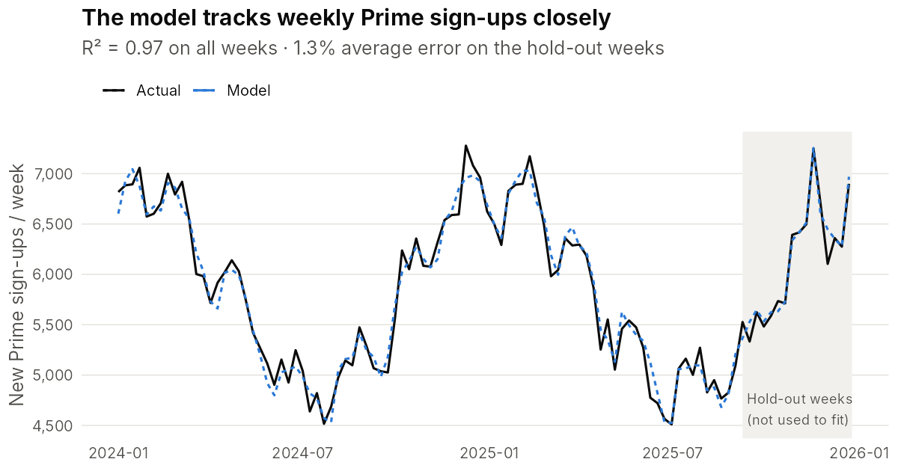
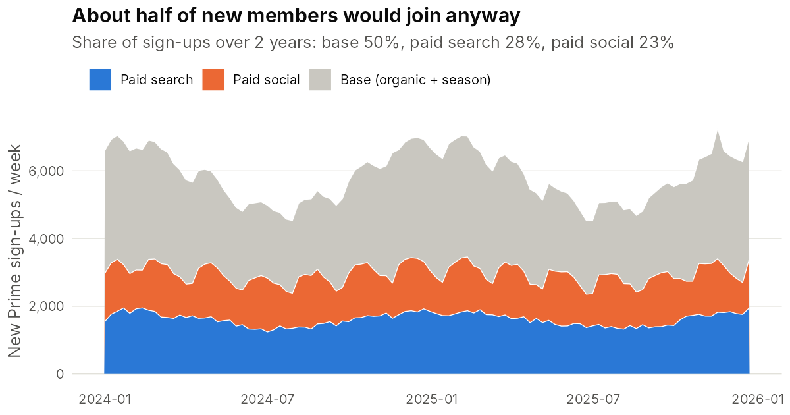
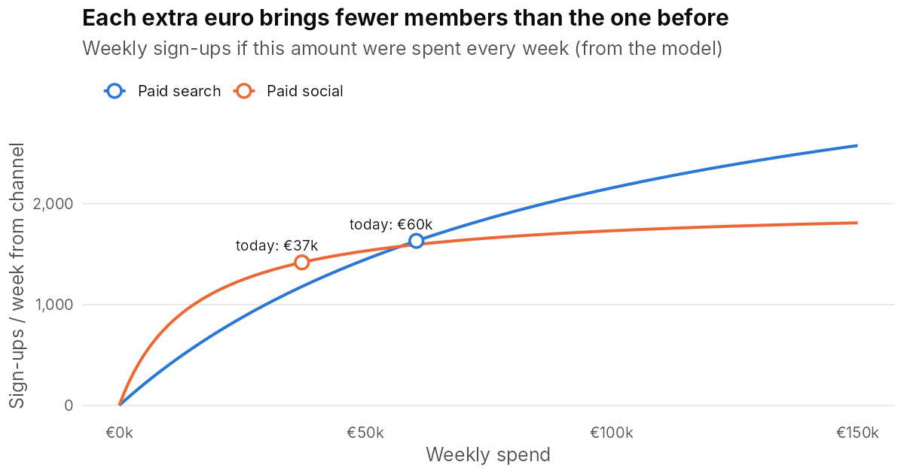
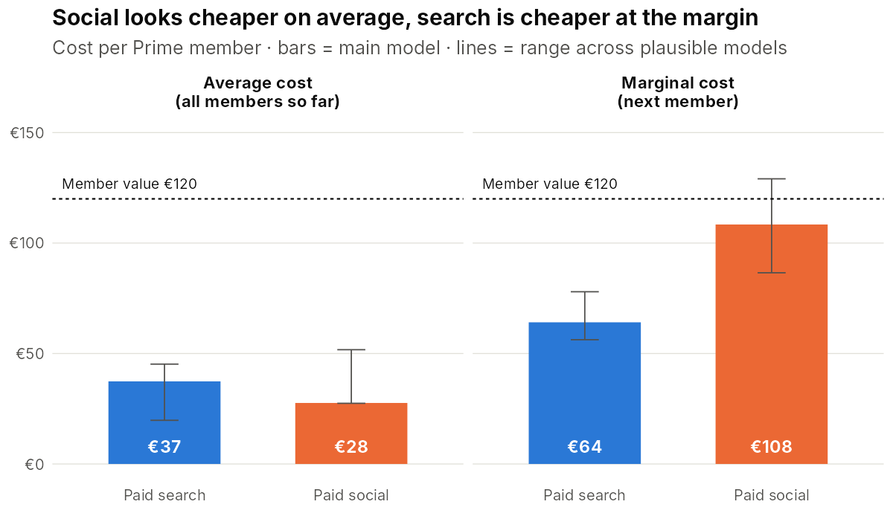
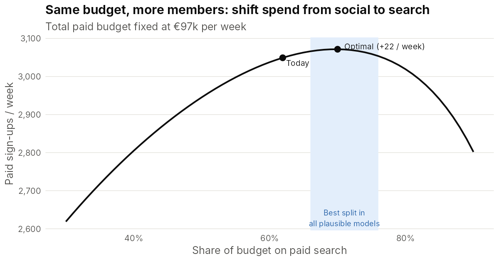

# Marketing Mix Model for a travel subscription: paid search vs paid social

**How should an online travel agency split its paid budget to win the most new subscription members?**

In this project I built a Marketing Mix Model (MMM) in R to answer that question for an online travel agency, which I'll call **Company X**. I took two years of weekly spend and sign-up data and turned them into a concrete budget recommendation.

The data comes from a real case. To protect confidentiality, I changed the company name and adjusted the figures slightly, keeping the patterns and the conclusions intact.

| | |
|---|---|
| **Business question** | Which channel brings new members most cheaply, and how should we split the budget? |
| **Data** | 104 weeks, one market (Spain), slightly modified for privacy |
| **Channels** | Paid search, paid social |
| **KPI** | New subscription members per week, valued at lifetime value (LTV) |
| **Method** | Adstock + saturation transformations, linear regression, grid search validated on hold-out weeks |
| **Tools** | R (base R + ggplot2) |

---

## 1. Business context

What I find most interesting about this case is that, for a travel subscription business, the goal of paid marketing changes. It's no longer about buying a single booking. It's about **acquiring a member**, who pays a yearly fee and then books again and again without any new ad spend.

That changes the questions marketing needs answered:

1. How many new members does each channel **really** cause, beyond those who would join anyway?
2. What does a new member cost per channel, **on average and at the margin**?
3. With the same budget, what split between search and social gives the most members?

## 2. Data

`data/weekly_spain.csv`: one row per week.

| Column | Meaning |
|---|---|
| `member_signups` | New members that week (KPI) |
| `search_spend` | Paid search spend, EUR. Always on, higher in peak season |
| `social_spend` | Paid social spend, EUR. 4-week campaigns, then a low always-on level |
| `season` | Travel demand index, peaking in January when people plan their summer |
| `black_friday` | 1 in Black Friday weeks |

> The figures have been slightly modified to protect the company's confidential information. The patterns, and therefore the conclusions, are the same as in the original data.

## 3. Method

```
spend ──► adstock ──► saturation ──► regression ──► contributions, ROI, budget curves
          (carryover)  (diminishing
                        returns)
```

**Adstock: ads keep working after the week they run.** Someone who sees an Instagram ad may sign up two weeks later. `theta` is the share of last week's effect that carries over.

```r
adstock <- function(x, theta) {
  out <- numeric(length(x)); carry <- 0
  for (t in seq_along(x)) { carry <- x[t] + theta * carry; out[t] <- carry }
  out
}
```

**Saturation: each extra euro buys less.** Search is an auction: once you're at the top of the page, bidding more buys few extra clicks. `K` is the spend at which a channel reaches half of its maximum effect.

```r
saturation <- function(x, K) x / (x + K)
```

**Regression:**

```r
lm(member_signups ~ search_t + social_t + season + black_friday)
```

**Choosing `theta` and `K`:** I tried 320 combinations. I fitted each one on the first 88 weeks and scored it on the last 16, which the model never saw. The best one became the main model. I also kept every model within 10% of the best error (67 in total) as "plausible", so I could show how uncertain the results are instead of reporting a single number.

## 4. Results

### The model fits well, including on unseen weeks



R² = 0.97. The average error on the 16 hold-out weeks is 1.3%. Both channels have positive, significant effects.

### About half of new members would join anyway



| Driver | Share of sign-ups (2 years) |
|---|---|
| Base (organic + season + Black Friday) | 50% |
| Paid search | 28% |
| Paid social | 23% |

This was the first insight for the business. Last-click attribution would credit paid media with many of the members in the base, who would have joined anyway.

### Diminishing returns in both channels



Social rises fast and flattens early. Search keeps growing at higher spend.

### The key finding: average cost and marginal cost point in different directions



| | Paid search | Paid social |
|---|---|---|
| Spend (2 years) | €6.28M | €3.86M |
| Members driven | 167,900 | 139,800 |
| **Average cost per member** | **€37** | **€28** |
| ROI on LTV (€120 per member) | 3.2 | 4.3 |
| Extra members per extra €10k/week | +156 | +92 |
| **Marginal cost per member** | **€64** (range €56–78) | **€108** (range €87–129) |

This is the result I'm most proud of. On average, social looks like the better channel. But budget decisions are about the **next** euro, and there search is much cheaper: €64 versus €108 for social, which is close to the €120 a member is worth. Social's cheap members have already been bought.

#### How the marginal cost is calculated

I predict weekly sign-ups at today's spend, predict them again with €10k more per week, and divide the €10k by the extra sign-ups. With steady weekly spend `s`, adstock settles at `s / (1 − theta)`, so:

```r
weekly_response <- function(s, theta, K, beta) beta * saturation(s / (1 - theta), K)
marginal_cost   <- 10000 / (weekly_response(s + 10000, ...) - weekly_response(s, ...))
```

| Step | Paid search: today | Paid search: +€10k | Paid social: today | Paid social: +€10k |
|---|---|---|---|---|
| Weekly spend | €60,360 | €70,360 | €37,117 | €47,117 |
| 1. Adstock = spend / (1 − theta) | 75,450 | 87,950 | 61,861 | 78,528 |
| 2. Saturation = A / (A + K) | 0.386 | 0.423 | 0.712 | 0.759 |
| 3. Sign-ups = beta × saturation | 1,631 | 1,787 | 1,418 | 1,510 |
| 4. Extra sign-ups | | **+156** | | **+92** |
| 5. Marginal cost = 10,000 / extra | | **€64** | | **€108** |

Model parameters: search theta = 0.2, K = €120k, beta = 4,225; social theta = 0.4, K = €25k, beta = 1,991.

Step 2 explains the result. At today's spend, social already works at 71% of its maximum effect, while search is only at 39%, so search has much more room to grow. The full calculation is printed by `R/03_roi_and_budget.R` and saved in [`output/marginal_cost_steps.csv`](output/marginal_cost_steps.csv).

### Same budget, more members



| Scenario | Search / week | Social / week | Paid members / week |
|---|---|---|---|
| Today (62% search) | €60.4k | €37.1k | 3,049 |
| Optimal (70% search) | €68.2k | €29.2k | 3,072 |

The gain is modest: +22 members a week, about +1,150 a year, worth about €140k in lifetime value at no extra cost. What matters more to me is that **all 67 plausible models agree on the direction**: the best split is 66–76% on search, above today's 62%. The size of the effect is uncertain, but the decision is robust.

## 5. Recommendation

1. **Shift about 8 percentage points of the paid budget from social to search** (about €8k a week). Every plausible model says search should get a bigger share.
2. **Don't cut social to zero.** It's still profitable at the margin, and its effect lasts for weeks after each campaign. Judging it on same-week sign-ups would undervalue it.
3. **Validate before scaling.** I'd run a geo holdout test: raise search and lower social in a few regions for 6–8 weeks and compare them with matched control regions. The result would then be used to calibrate the next model.
4. **Value members at lifetime value, not first booking.** Measured on the margin of a single booking, both channels would look far less profitable than they really are.

## 6. Limitations and next steps

- **Weakly identified saturation:** many curve shapes fit the data almost equally well, so the size of each channel's contribution is uncertain. That's why I report ranges, not single numbers, and why I'd calibrate the MMM with experiments before making large budget moves.
- **Endogeneity:** search spend follows demand (it's higher in January). I control for seasonality, but the model could still over-credit search in peak weeks. A search holdout test would check this.
- **Brand vs generic search:** brand searches ("Company X flights") come from people who are already looking for the company. With more granular data I would split them, because brand search usually has a much lower true incremental effect.
- **One market, two channels:** a complete model would cover several countries with a hierarchical (multilevel) model, so that small markets can borrow strength from big ones.
- **Lifetime value is an assumption** (€120). Ideally I'd estimate LTV per acquisition channel from cohorts, since members acquired through social might renew less than those from search.
- **Next tools:** Meta's Robyn (R) or Google's Meridian for production use. Both support calibration with experiments.

## How to run

```r
install.packages(c("ggplot2", "scales"))
```

```bash
Rscript R/run_all.R
```

| Script | What it does |
|---|---|
| `R/00_functions.R` | Adstock, saturation and response-curve helpers |
| `R/02_fit_model.R` | Grid search with hold-out validation, final model, decomposition |
| `R/03_roi_and_budget.R` | ROI, marginal cost, budget scenarios, uncertainty ranges |
| `R/04_charts.R` | Creates the charts in `output/figures/` |

---

*The company name has been changed and the data slightly modified to protect confidentiality.*
